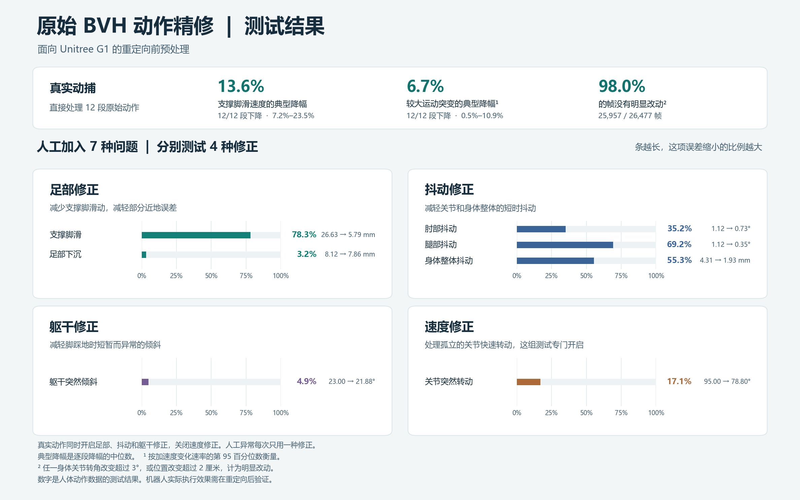

# BVH 动作精修测试汇总



## 图怎么读

图上方汇总 12 段原始动捕的结果。测试时同时开启足部、抖动和躯干修正，速度修正关闭。12 段的支撑脚滑速度和 Jerk P95 均下降。脚滑前后使用同一组原始支撑区间和地面参考，逐段降幅范围为 **7.2%–23.5%**。逐段降幅的中位数为 **13.6%**。Jerk P95 的逐段降幅范围为 **0.5%–10.9%**，中位数为 **6.7%**。中位数即把 12 个降幅排序后取中间两个值的平均。

下方四个等大区域分别展示足部、时序平滑、躯干和速度的 7 项人工异常测试。每项只开启对应模块，和未注入的原动作比较。条形使用统一的 0–100% 尺度，表示注入区间的均方根误差（RMS）降幅。旁边的数值是修改前后误差，角度用度，位置用毫米。

12 段共 26,477 帧，其中 **25,957 帧（98.0%）**没有超过明显修改阈值。阈值为任一身体关节的局部旋转变化超过 3°，或世界位置变化超过 20 mm。这是项目约定的可解释门槛。全段平均位置改动在不同动作中为 **0.09–0.83 mm**，逐段中位数为 0.46 mm。该值本身是修改距离。换算为百分比需要另选参照，例如身高或动作幅度。

真实样本的平均穿地深度按每段等权汇总，从 0.243 mm 降到 0.224 mm。该指标对估计地面计算，并把没有穿地的帧计作零。全段躯干倾角 P95 基本不变，变化最大的样本也只有约 0.003°。这项统计包含正常倾身，无法单独反映短时异常是否被修正。

## 使用了哪些指标

支撑脚滑、穿地深度、关节位置距离和 Jerk 都有公开研究先例。不同研究会采用不同的足部点、地面来源、接触标签和统计量。项目采用输入推断的足跟/足尖支撑区间和估计地面，前后共用参考。关节位置距离以原动作作参照，衡量改动量。Jerk P95 关注关节位置三阶差分的较高值。明显修改帧的 3°/20 mm 阈值是本项目定义。 [UnderPressure](https://arxiv.org/abs/2208.04598) · [CVPRW 2025 动作重建评估](https://www.openaccess.thecvf.com/content/CVPR2025W/RHOBIN/papers/Aytekin_Physics-based_Human_Pose_Estimation_from_a_Single_Moving_RGB_Camera_CVPRW_2025_paper.pdf) · [MANIKIN（ECCV 2024）](https://www.ecva.net/papers/eccv_2024/papers_ECCV/papers/00194.pdf)

## 强度是怎么测的

| 测试 | 整体强度 | 分项配置 |
| --- | --- | --- |
| 图上方的 12 段真实动作 | 50 | 足部 80、平滑 80、躯干 40、速度关闭 |
| 原报告的整体强度对照，3 段真实动作 | 0 / 50 / 100 | 分项固定为上述默认配置 |
| 图下方的 7 项人工异常 | 50 | 只开启对应模块，足部 80、平滑 80、躯干 40，速度尖峰单测为 100 |
| 下表的分项补测，7 项人工异常 | 50 | 每次只开启对应模块，分项为 0 / 25 / 50 / 100 |

以下为注入区间 RMS 误差降幅。分项 0 的 7 项均逐字节保留输入，误差变化为 0。

| 单独启用的模块 | 注入异常 | 弱 25 | 中 50 | 强 100 |
| --- | --- | ---: | ---: | ---: |
| 足部 | 支撑脚滑 | 52.8% | 69.1% | 81.9% |
| 足部 | 足部下沉 | 1.7% | 2.4% | 3.7% |
| 平滑 | 肘部抖动 | 18.5% | 32.2% | 32.8% |
| 平滑 | 腿部抖动 | 30.1% | 55.6% | 69.1% |
| 平滑 | 身体整体抖动 | 16.8% | 35.6% | 64.4% |
| 躯干 | 倾斜尖峰 | 3.0% | 6.2% | 12.5% |
| 速度 | 角速度尖峰 | 4.5% | 8.8% | 17.1% |

这些是固定注入条件下的分项敏感度测试。原基准的肘部抖动在分项 80 时下降 35.2%，高于本次 100 档的 32.8%，说明强度收益并不总是单调。若要为实际业务设定推荐档位，下一步可对业务 BVH 做盲看保真对比，优先检查快转身、落脚、抬腿和原本干净的动作。若要判断机器人重定向后的稳定性，需要另做机器人侧验证。

基准明细见 [英文基准报告](benchmark.md)，分项补测的逐档数值见 [CSV](strength_sweep.csv)。补测与原基准使用同一数据版本、同一注入脚本和固定 Python 依赖。在项目目录中复现补测。

```bash
python fetch_samples.py
python benchmark_strength.py --output runs/strength_sweep.csv
```
